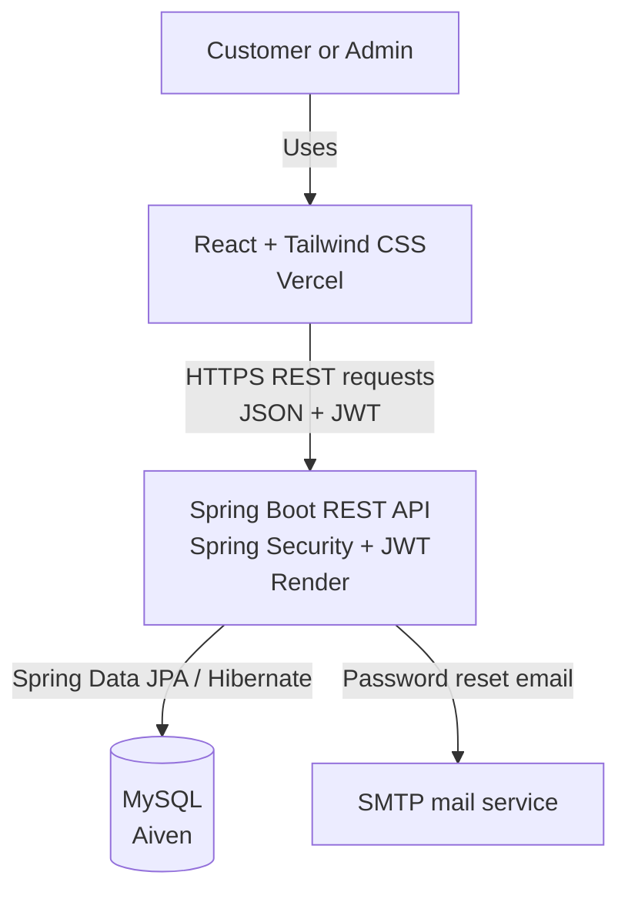

<div align="center">

# 🏦 BANKFLOW

### Full-Stack Banking Application

A full-stack portfolio project that brings everyday banking workflows into one web application — from account transactions to loan applications and repayment tracking.

<p>
  <a href="https://bankflow-frontend.vercel.app/"></a>
  <a href="https://github.com/GauriShinde09/BANKFLOW-frontend"></a>
  <a href="https://github.com/GauriShinde09/BANKFLOW-backend"></a>
</p>

<p>
  
  
  
  
  
  
</p>

> **Portfolio / educational demo only.** BANKFLOW is not a real banking service. Use demo data only—never enter real financial, identity, or sensitive personal information.

</div>

---

## 📌 Project at a glance

BANKFLOW demonstrates how a modern React frontend can communicate with a Java Spring Boot REST API, authenticate users with JWT, persist data in MySQL, and support role-based banking and loan workflows.

| | Details |
|---|---|
| **Live application** | [bankflow-frontend.vercel.app](https://bankflow-frontend.vercel.app/) |
| **Backend service** | [bankflow-backend-mhnx.onrender.com](https://bankflow-backend-mhnx.onrender.com/) |
| **Frontend repository** | [BANKFLOW-frontend](https://github.com/GauriShinde09/BANKFLOW-frontend) |
| **Backend repository** | [BANKFLOW-backend](https://github.com/GauriShinde09/BANKFLOW-backend) |
| **Database** | MySQL hosted on Aiven |
| **Deployment** | Vercel · Render · Aiven |

## ✨ Features

### 🔐 Authentication and access control

- User registration and login with password hashing using BCrypt.
- JWT-based authentication for secured API requests.
- Role-based access for customers and administrators.
- Forgot-password and password-reset flow using email and expiring, one-time reset tokens.
- Passwords are excluded from normal user response serialization.

### 💳 Everyday banking

- View account details and current balance.
- Deposit, withdraw, and transfer funds.
- Add beneficiaries and transfer to saved beneficiaries.
- View paginated transaction history, including debit/credit types and counterparty details.
- Download an account statement as a PDF.
- Admin controls to freeze and unfreeze accounts.

### 🏦 Loan management

- Browse available loan types and submit loan applications.
- Provide requested amount, tenure, and monthly income for a demo eligibility check.
- Admin management of loan types, including create, update, activate, and deactivate operations.
- Admin review of applications with approve/reject decisions and rejection reasons.
- Disburse approved loans to the customer's bank account.
- Generate repayment schedules with principal, interest, and remaining balance.
- Track EMI repayments and mark a loan complete after all scheduled repayments are paid.

> **Eligibility note:** Loan eligibility is a simplified project rule based on declared income and estimated EMI. It is for demonstrating application logic only and is not a real credit assessment.

## 🧰 Tech stack

| Area | Technologies |
|---|---|
| Frontend | React, Vite, Tailwind CSS, Axios, React Router |
| Backend | Java, Spring Boot, Spring Web / REST APIs |
| Security | Spring Security, JWT, BCrypt, role-based authorization, CORS configuration |
| Persistence | Spring Data JPA, Hibernate, MySQL |
| Supporting features | Spring Boot Mail / SMTP, Apache PDFBox |
| Tools | Git, GitHub, Maven, Postman, VS Code / Spring Tools |
| Hosting | Vercel (frontend), Render (backend), Aiven (MySQL) |

## 🏗️ Architecture



### Request flow

1. A user interacts with the React application.
2. Axios sends HTTP requests to the Spring Boot API.
3. Spring Security and JWT protect secured endpoints and enforce access rules.
4. Spring Data JPA / Hibernate reads and writes records in MySQL.
5. The API returns JSON responses; the frontend displays the result.

## 🧪 Try the live demo

1. Open the [BANKFLOW live application](https://bankflow-frontend.vercel.app/).
2. Register a demo account or sign in with a test account you control.
3. Explore the features available to your role.

The backend may take a short time to respond after inactivity depending on the hosting plan. If a request fails, check the browser console and service logs before retrying.

## 💻 Run locally

The application code lives in two repositories so the frontend and backend can be developed and deployed independently.

### Prerequisites

- Node.js and npm for the frontend.
- A JDK and Maven version compatible with the backend's `pom.xml`.
- A MySQL database.
- Optional SMTP credentials to test password-reset email.

### 1. Get the repositories

```bash
git clone https://github.com/GauriShinde09/BANKFLOW-frontend.git
git clone https://github.com/GauriShinde09/BANKFLOW-backend.git
```

### 2. Configure and start the backend

Open `BANKFLOW-backend` in your IDE. Configure the required environment variables in your local run configuration. Use your own database and email credentials—do not copy production secrets into source control.

| Environment variable | Purpose |
|---|---|
| `DB_URL` | JDBC URL for the MySQL database |
| `DB_USERNAME` | Database username |
| `DB_PASSWORD` | Database password |
| `JWT_SECRET` | Strong Base64-encoded JWT signing key |
| `MAIL_USERNAME` | SMTP sender account |
| `MAIL_APP_PASSWORD` | SMTP app password |
| `APP_FRONTEND_URL` | Frontend origin allowed by the backend |
| `DDL_AUTO` | Hibernate schema setting, such as `update` for development |
| `SHOW_SQL` | Enable or disable SQL logging |

Start the Spring Boot application using the IDE or the Maven command supported by the project configuration.

### 3. Configure and start the frontend

In the `BANKFLOW-frontend` directory, create a local `.env` file containing the local API URL:

```env
VITE_API_BASE_URL=http://localhost:8085
```

Then run:

```bash
npm install
npm run dev
```

Vite variables prefixed with `VITE_` are bundled into the browser application. **Never place passwords, database credentials, JWT secrets, or other private values in frontend environment variables.**

## 🔒 Security and responsible use

- This is an educational portfolio project, not a production banking platform.
- Use fictional/demo data only.
- Never commit `.env` files, passwords, SMTP app passwords, JWT signing keys, access tokens, or SQL backup files.
- Store secrets in local environment settings and the relevant hosting platform's environment configuration.
- Real financial products require extensive security review, monitoring, resilience testing, fraud controls, legal/regulatory compliance, and operational safeguards beyond this project.

## 👩‍💻 Author

**Gauri Shinde** · [GitHub @GauriShinde09](https://github.com/GauriShinde09)

Built to practise full-stack development, secure REST APIs, database-backed workflows, and cloud deployment with Java and React.

---

<p align="center"><i>Banking, made clearer. Built as a learning project.</i></p>
